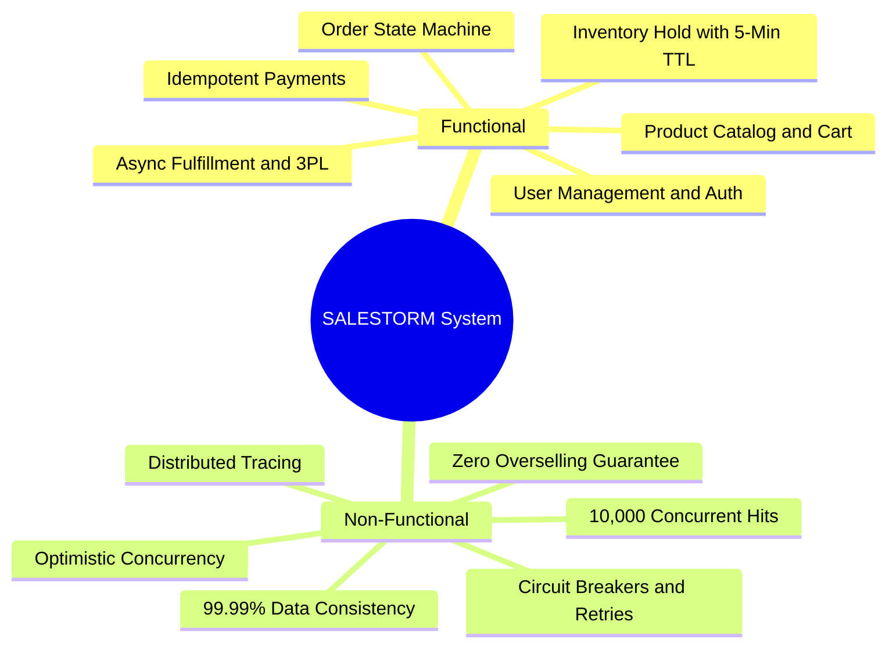
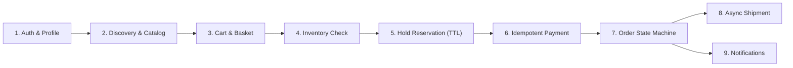
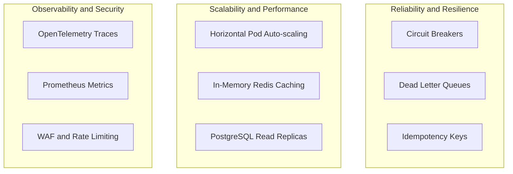
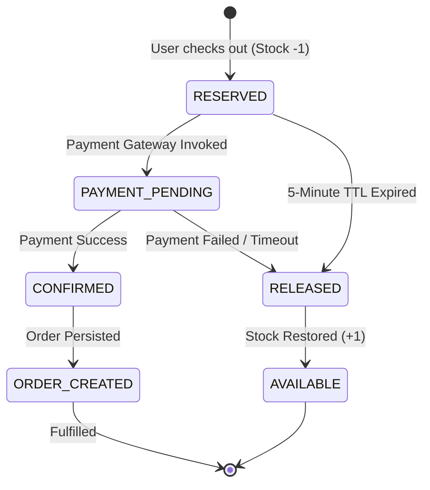

# 01. System Requirements and Flash-Sale Specifications

[Back to System Overview](../README.md) |
[Next: 02 High-Level Design ->](../02_HLD/README.md)

---

## Executive Summary

SALESTORM is an enterprise-grade flash-sale e-commerce platform designed to eliminate race conditions, overselling, and inventory locking when massive user concurrency overwhelms standard transactional systems.

---

## The Flash Sale Core Challenge

| Parameter | Flash Sale Baseline | Extreme Spike Peak |
|---|---|---|
| **Available Stock** | **100 Units** | **1,000 Units** |
| **Concurrent Buyers** | **10,000 Users** | **500,000 Users** |
| **Max Permissible Oversell** | **0 Units** *(Strict Zero)* | **0 Units** *(Strict Zero)* |
| **Hold Expiration Window** | **300 Seconds (5 mins)** | **180 Seconds (3 mins)** |
| **Duplicate Retries Target** | Handled idempotently | Handled idempotently |

---

## 1. Functional Requirements (FR)

<b>Detailed Functional Specifications (Click to expand/collapse)</b>

### FR1. User Management and Authentication
- Secure registration, login, and token generation via **OAuth2 / JWT**.
- Secure session state and authorization filters per role (`CUSTOMER`, `ADMIN`).

### FR2. Product Discovery and Catalog
- High-read caching for flash-sale product metadata, specs, and dynamic countdown timers.
- Read-optimized responses capable of handling traffic surges without database read-lock starvation.

### FR3. Shopping Cart Management
- Real-time basket updates, item additions, quantity caps (max 1 unit per customer during flash sales).
- Pre-checkout validation of item eligibility and active sale windows.

### FR4 & FR5. Inventory Management and Atomic Hold Reservation
- Real-time tracking of `available_quantity`, `reserved_quantity`, and `sold_quantity`.
- Temporary inventory reservations with a **5-minute time-to-live (TTL)**.
- Release of stock back to the active pool immediately upon checkout abandonment or payment failure.

### FR6. Idempotent Payment Processing
- Integration with external payment gateways (UPI, Cards, NetBanking, Wallets).
- Mandatory `Idempotency-Key` headers preventing double charges from user retries.
- Automatic webhook reconciliation for in-flight/ambiguous payment transactions.

### FR7. Order Lifecycle and State Transitions
- Strict state-machine transitions: `CREATED` -> `PAYMENT_PENDING` -> `CONFIRMED` -> `PROCESSING` -> `SHIPPED` -> `DELIVERED`.
- Outbox pattern for reliable post-payment order persistence.

### FR8 & FR9. Logistics and Asynchronous Notifications
- Decoupled shipment creation via event queues to 3PL logistics APIs.
- Multi-channel alerts (SMS, Email, Push) for order confirmation, shipping updates, and delivery alerts.

---

## 2. Non-Functional Requirements (NFR)

| NFR Category | SLA / Target Metric | Architectural Solution |
|---|---|---|
| **NFR1. Scalability** | 10,000 concurrent req/sec peak | Horizontal service scaling, Redis cache tier, Load Balancers |
| **NFR2. Consistency** | 100% strict consistency (0 oversell) | PostgreSQL ACID transactions, Versioned Optimistic Locking, Atomic Redis Lua |
| **NFR3. Concurrency** | Sub-50ms stock decision response | Atomic in-memory hold gates, non-blocking asynchronous event dispatch |
| **NFR4. Reliability** | 99.99% availability | Timeouts, Exponential backoff retries, Resilience4j Circuit Breakers |
| **NFR5. Idempotency** | 100% duplicate protection | Unique Redis-backed client UUID check on all mutative APIs |
| **NFR6. Security** | Zero plain-text secrets, TLS 1.3 | WAF bot shielding, JWT signatures, bcrypt hashing, Vault secrets |
| **NFR7. Observability** | Full trace visibility across mesh | Prometheus metrics, Grafana dashboards, OpenTelemetry distributed tracing |

---

## 3. Failure Modes and Automated Recovery Matrix

| Failure Scenario | Root Cause | Automated Recovery Mechanism |
|---|---|---|
| **Payment Gateway Timeout** | 3rd party bank outage / network drop | Auto-reconciliation worker polls status; if unpaid within 5 min, hold is canceled & stock is restored. |
| **Customer Abandons Cart** | Browser closed during payment | Redis TTL expires after 300s; background event publishes `reservation.expired` restoring stock. |
| **Order Service Down Post-Pay** | Transient database blip | Payment service queues `payment.succeeded` in durable Kafka queue with DLQ retry. |
| **Duplicate Buy Clicks** | User spams "Buy Now" button | Idempotency filter traps second request instantly and returns current reservation handle. |

---

[Return to Root Overview](../README.md) | [Proceed to 02_HLD ->](../02_HLD/README.md)