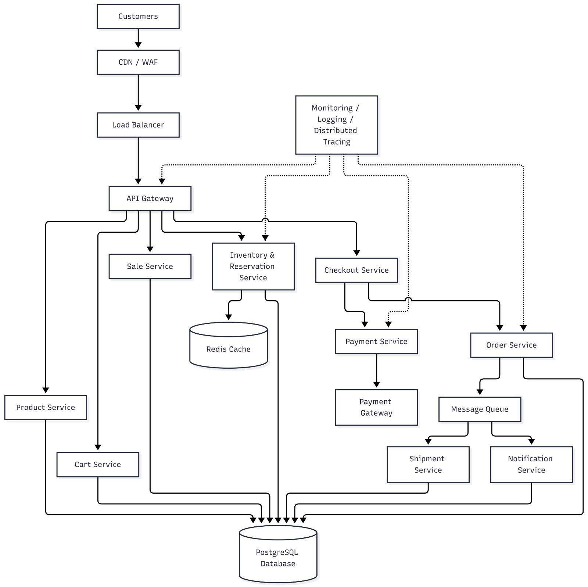
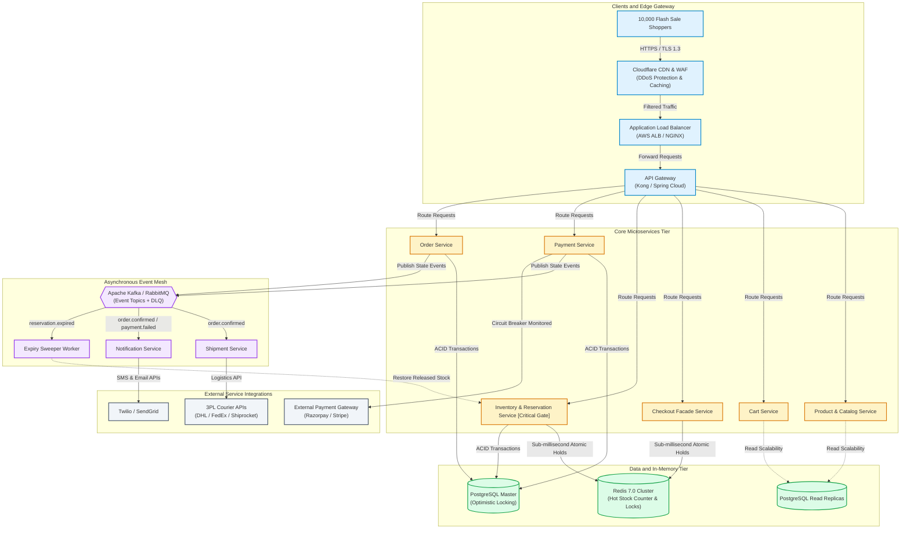
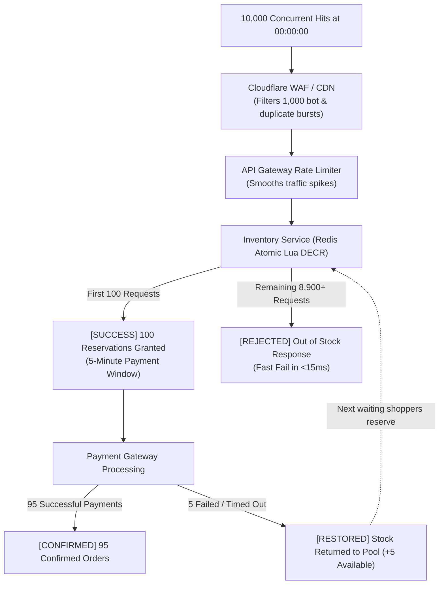

# 02. High-Level Design (HLD)

[Back to Overview](../README.md) |
[Prev: 01 Requirements](../01_Requirements/README.md) |
[Next: 03 Low-Level Design ->](../03_LLD/README.md)

---

## Architecture Diagram Preview

*Figure 2.1: SALESTORM High-Level Architecture Diagram — Ingestion, Microservices Mesh, Storage and Async Fulfillment Tier*

---

## 1. Interactive C4 Container Architecture

---

## 2. Microservice Boundaries and Responsibilities

| Service | Primary Domain | Scaling Strategy | Failure Mode Mitigation |
|---|---|---|---|
| **API Gateway** | Rate limiting, Auth validation, Header tracing | Auto-scaled edge pods | Return `429 Too Many Requests` on surge beyond capacity |
| **Product Service** | Catalog browsing, Flash-sale countdowns | 99% Read Cached in Redis & CDN | Stale-while-revalidate caching fallback |
| **Cart Service** | Temporary user baskets and validation | In-Memory Redis session backing | Ephemeral storage with graceful cleanup |
| **Inventory Service [Gate]** | Concurrency-safe atomic reservations | Redis Lua Scripts + PostgreSQL locks | Strict rejection when stock hits 0; zero overselling |
| **Checkout Service** | Orchestration Facade across services | Stateless horizontal scaling | Idempotent transaction orchestration |
| **Payment Service** | Gateway integrations and reconciliation | Stateless workers with Circuit Breakers | Resilience4j Circuit Breaker + Auto-reconciliation worker |
| **Order Service** | State machine and order confirmation | ACID Transactions + Outbox pattern | Asynchronous retries via Dead Letter Queues |
| **Shipment Service** | 3PL logistics dispatch and tracking | Event-driven background consumers | Message queue consumer retry with exponential backoff |
| **Notification Service**| Email, SMS, and Push alert dispatch | Asynchronous queue consumers | Batching and circuit breaker on 3rd party providers |

---

## 3. The Flash Sale 10,000 : 100 Traffic Funnel

---

## Related Modules and Diagrams

- **Interactive Draw.io Diagram**: [`SALESTORM_SYSTEM_FLOW.drawio`](../SALESTORM_SYSTEM_FLOW.drawio)
- **Low-Level Code and Sequences**: [`03_LLD/README.md`](../03_LLD/README.md)
- **PostgreSQL and Redis Design**: [`04_Database/README.md`](../04_Database/README.md)
- **Architecture Decisions (ADRs)**: [`10_ADR/README.md`](../10_ADR/README.md)

---

[Return to System Overview](../README.md) | [Proceed to 03_LLD ->](../03_LLD/README.md)