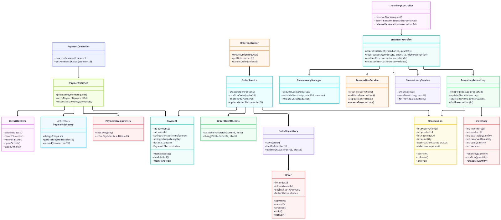
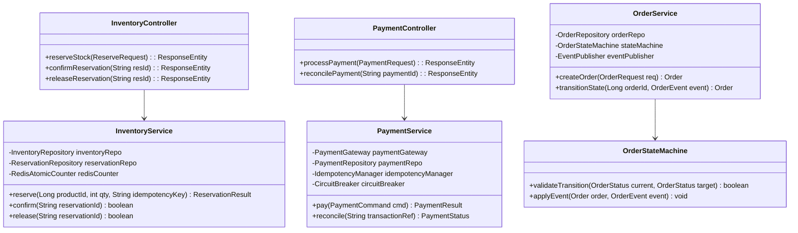
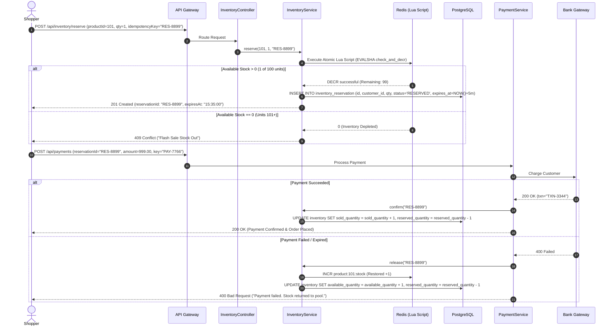
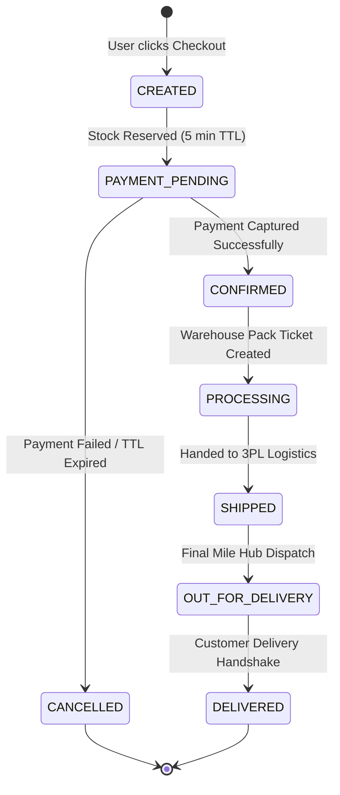

<div align="center">

# 03. Low-Level Design (LLD) and Sequence Workflows

[]()
[]()
[]()

[Back to Overview](../README.md) |
[Prev: 02 High-Level Design](../02_HLD/README.md) |
[Next: 04 Database Design ->](../04_Database/README.md)

---

</div>

## LLD Diagram Preview

<div align="center">



*Figure 3.1: SALESTORM Low-Level Design — Class Architecture, Service Controllers, Repositories, and State Machines*

</div>

---

## 1. Core Class Hierarchy and Component Model



---

## 2. Concurrency-Safe Flash Sale Sequence



---

## 3. Deterministic Order State Machine



---

## 4. Concurrency and Optimistic Lock Implementation

<details open>
<summary><b>Atomic SQL Update Query (Click to Expand)</b></summary>

```sql
-- Prevents race conditions at the database level with version validation
UPDATE inventory
SET 
    available_quantity = available_quantity - 1,
    reserved_quantity = reserved_quantity + 1,
    version = version + 1,
    updated_at = CURRENT_TIMESTAMP
WHERE 
    product_id = :productId 
    AND available_quantity >= 1 
    AND version = :currentVersion;
```

</details>

---

[Return to System Overview](../README.md) | [Proceed to 04_Database ->](../04_Database/README.md)