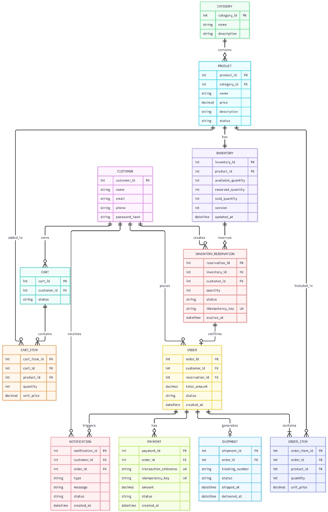
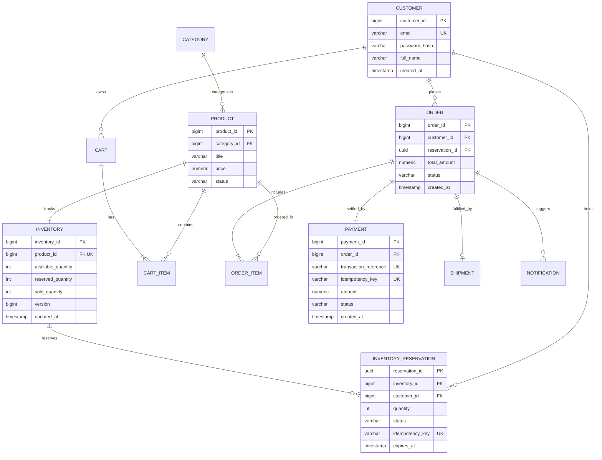

<div align="center">

# 04. Database Architecture and Relational Schema

[]()
[]()
[]()

[Back to Overview](../README.md) |
[Prev: 03 Low-Level Design](../03_LLD/README.md) |
[Next: 05 API Design ->](../05_API/README.md)

---

</div>

## Database Diagram Preview

<div align="center">



*Figure 4.1: SALESTORM Relational Database Schema — Entity Relationships, Foreign Keys, and Concurrency Controls*

</div>

---

## 1. Interactive Entity Relationship (ER) Diagram



---

## 2. Comprehensive Table Definitions

<details open>
<summary><b>Core DDL Specifications (Click to expand/collapse)</b></summary>

### 1. `INVENTORY` and `INVENTORY_RESERVATION`
```sql
CREATE TABLE inventory (
    inventory_id BIGSERIAL PRIMARY KEY,
    product_id BIGINT NOT NULL UNIQUE REFERENCES product(product_id),
    available_quantity INT NOT NULL CHECK (available_quantity >= 0),
    reserved_quantity INT NOT NULL DEFAULT 0 CHECK (reserved_quantity >= 0),
    sold_quantity INT NOT NULL DEFAULT 0 CHECK (sold_quantity >= 0),
    version BIGINT NOT NULL DEFAULT 0,
    updated_at TIMESTAMP WITH TIME ZONE DEFAULT CURRENT_TIMESTAMP
);

CREATE TABLE inventory_reservation (
    reservation_id UUID PRIMARY KEY DEFAULT gen_random_uuid(),
    inventory_id BIGINT NOT NULL REFERENCES inventory(inventory_id),
    customer_id BIGINT NOT NULL REFERENCES customer(customer_id),
    quantity INT NOT NULL DEFAULT 1,
    status VARCHAR(30) NOT NULL DEFAULT 'RESERVED', -- RESERVED, CONFIRMED, RELEASED, EXPIRED
    idempotency_key VARCHAR(128) NOT NULL UNIQUE,
    expires_at TIMESTAMP WITH TIME ZONE NOT NULL,
    created_at TIMESTAMP WITH TIME ZONE DEFAULT CURRENT_TIMESTAMP
);

CREATE INDEX idx_inv_res_expires ON inventory_reservation(expires_at) WHERE status = 'RESERVED';
```

### 2. `PAYMENT` and `ORDER`
```sql
CREATE TABLE orders (
    order_id BIGSERIAL PRIMARY KEY,
    customer_id BIGINT NOT NULL REFERENCES customer(customer_id),
    reservation_id UUID NOT NULL REFERENCES inventory_reservation(reservation_id),
    total_amount NUMERIC(12, 2) NOT NULL,
    status VARCHAR(30) NOT NULL DEFAULT 'CREATED', -- CREATED, CONFIRMED, PROCESSING, SHIPPED, DELIVERED, CANCELLED
    created_at TIMESTAMP WITH TIME ZONE DEFAULT CURRENT_TIMESTAMP
);

CREATE TABLE payment (
    payment_id BIGSERIAL PRIMARY KEY,
    order_id BIGINT NOT NULL REFERENCES orders(order_id),
    transaction_reference VARCHAR(128) UNIQUE,
    idempotency_key VARCHAR(128) NOT NULL UNIQUE,
    payment_method VARCHAR(50) NOT NULL, -- UPI, CREDIT_CARD, WALLET
    amount NUMERIC(12, 2) NOT NULL,
    status VARCHAR(30) NOT NULL DEFAULT 'PENDING', -- PENDING, SUCCESS, FAILED, TIMEOUT
    created_at TIMESTAMP WITH TIME ZONE DEFAULT CURRENT_TIMESTAMP
);
```

</details>

---

## 3. Indexing and Optimization Strategy

| Index Name | Target Table | Indexed Columns | Purpose |
|---|---|---|---|
| `idx_inventory_product` | `inventory` | `product_id` (Unique) | Sub-millisecond lookup during stock checks |
| `idx_res_idempotency` | `inventory_reservation`| `idempotency_key` (Unique) | Deduplicate rapid consecutive click storms |
| `idx_res_expiry_status`| `inventory_reservation`| `(expires_at, status)` | Fast batch polling for expired hold cleanup |
| `idx_payment_idempotency`| `payment` | `idempotency_key` (Unique) | Prevent duplicate credit/bank charges |
| `idx_orders_customer` | `orders` | `(customer_id, created_at DESC)`| Rapid order history retrieval |

---

[Return to System Overview](../README.md) | [Proceed to 05_API ->](../05_API/README.md)