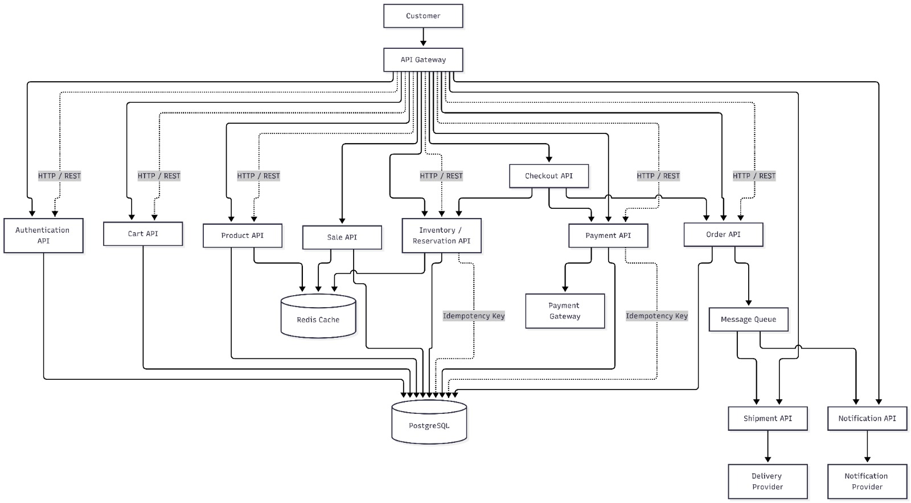

<div align="center">

# 05. RESTful API Specifications and Contracts

[]()
[]()
[]()

[Back to Overview](../README.md) |
[Prev: 04 Database Design](../04_Database/README.md) |
[Next: 06 SOLID Principles ->](../06_SOLID/README.md)

---

</div>

## API Architecture Diagram Preview

<div align="center">



*Figure 5.1: SALESTORM API Architecture — Gateway Ingestion, Routing, Endpoints, and Contract Definitions*

</div>

---

## 1. Critical Flash Sale Endpoints Matrix

| Domain | Verb | Endpoint | Description | Idempotent |
|---|:---:|---|---|:---:|
| **Inventory** | `POST` | `/api/inventory/reserve` | Atomic stock reservation (5 min TTL) | [YES] |
| **Inventory** | `POST` | `/api/inventory/reservations/{id}/confirm` | Confirm hold after successful payment | [YES] |
| **Inventory** | `POST` | `/api/inventory/reservations/{id}/release` | Release stock on payment failure | [YES] |
| **Payment** | `POST` | `/api/payments` | Process payment via gateway | [YES] |
| **Payment** | `POST` | `/api/payments/{id}/reconcile` | Poll uncertain/pending transaction | [YES] |
| **Order** | `POST` | `/api/orders` | Create confirmed order | [YES] |
| **Cart** | `POST` | `/api/cart/items` | Add flash sale item to cart | [NO] |

---

## 2. Interactive Request and Response Payloads

<details open>
<summary><b>1. Reserve Inventory Hold (POST /api/inventory/reserve)</b></summary>

#### Request:
- **Headers**: `Authorization: Bearer <JWT>`, `Idempotency-Key: RES-UUID-9988`
```json
{
  "productId": 101,
  "quantity": 1
}
```

#### Success Response (`201 Created`):
```json
{
  "reservationId": "9b1deb4d-3b7d-4bad-9bdd-2b0d7b3dcb6d",
  "productId": 101,
  "quantity": 1,
  "status": "RESERVED",
  "expiresAt": "2026-10-05T15:45:00.000Z",
  "ttlSecondsRemaining": 300
}
```

#### Out of Stock Response (`409 Conflict`):
```json
{
  "statusCode": 409,
  "errorCode": "INVENTORY_DEPLETED",
  "message": "All flash sale units have been reserved or sold.",
  "timestamp": "2026-10-05T15:40:02.100Z"
}
```

</details>

<details>
<summary><b>2. Process Payment (POST /api/payments)</b></summary>

#### Request:
- **Headers**: `Authorization: Bearer <JWT>`, `Idempotency-Key: PAY-TXN-4455`
```json
{
  "reservationId": "9b1deb4d-3b7d-4bad-9bdd-2b0d7b3dcb6d",
  "amount": 999.00,
  "currency": "INR",
  "paymentMethod": "UPI",
  "paymentDetails": {
    "vpa": "customer@okhdfcbank"
  }
}
```

#### Success Response (`200 OK`):
```json
{
  "paymentId": 5001,
  "transactionReference": "TXN_UPI_998822",
  "status": "SUCCESS",
  "amount": 999.00,
  "orderId": 8901,
  "timestamp": "2026-10-05T15:40:45.000Z"
}
```

</details>

---

## 3. Standard HTTP Status Code Conventions

| Status Code | Reason | Meaning in Flash Sale Context |
|---|---|---|
| `200 OK` | Success | Operation completed successfully (Order fetched, payment reconciled) |
| `201 Created` | Resource Created | Inventory reserved or order created successfully |
| `400 Bad Request` | Invalid Input | Malformed JSON or negative quantity requested |
| `401 Unauthorized`| Missing / Invalid Token | User session expired or missing JWT |
| `409 Conflict` | Stock Out / Lock Conflict | Flash sale inventory depleted or version mismatch |
| `429 Too Many Req`| Rate Limited | Customer hit rate cap (exceeded 500 req/min) |
| `503 Unavailable`| Gateway Overloaded | Circuit breaker active for payment gateway |

---

[Return to System Overview](../README.md) | [Proceed to 06_SOLID ->](../06_SOLID/README.md)