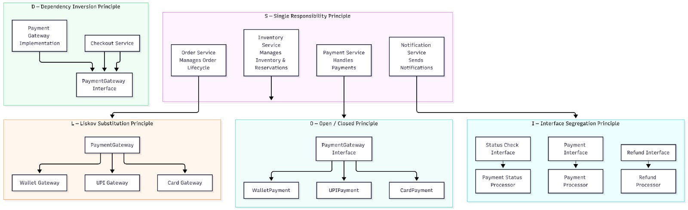
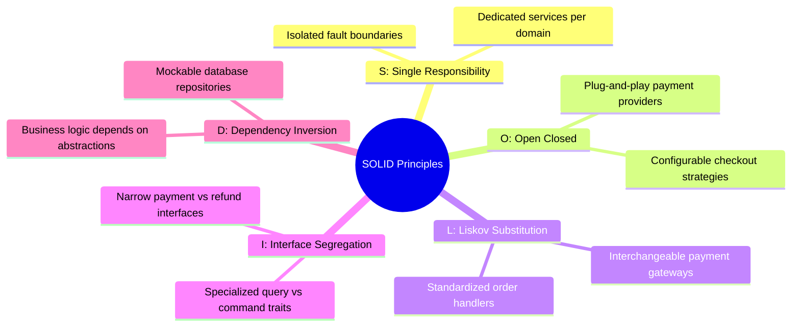
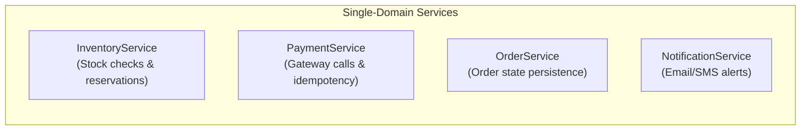
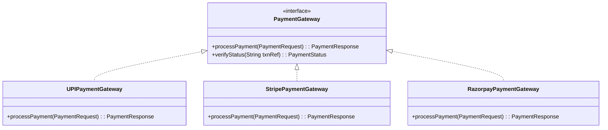
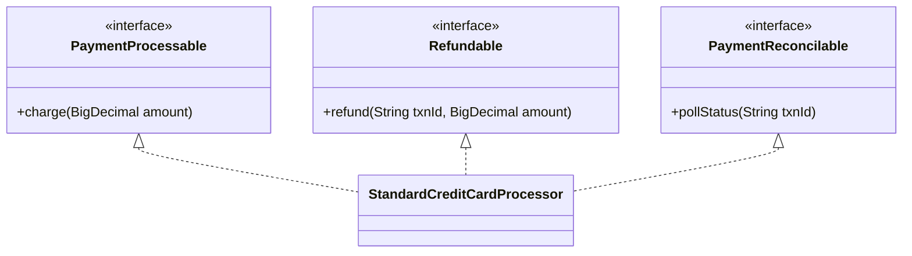
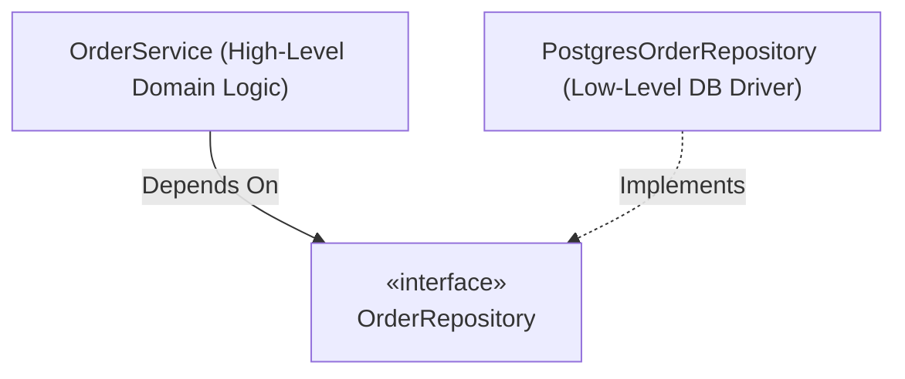

<div align="center">

# 06. SOLID Object-Oriented Principles in SALESTORM

[]()
[]()
[]()

[Back to Overview](../README.md) |
[Prev: 05 API Design](../05_API/README.md) |
[Next: 07 Design Patterns ->](../07_Design_Patterns/README.md)

---

</div>

## SOLID Architecture Diagram Preview

<div align="center">



*Figure 6.1: SALESTORM SOLID Principles Implementation — Domain Separation, Interfaces, and Dependency Inversion*

</div>

---

## Summary of SOLID Principles Applied



---

## 1. S — Single Responsibility Principle (SRP)

> **Rule:** *A class or module should have one, and only one, reason to change.*



- **In Practice:** Modifying bank payment handling never forces changes or redeployment of `InventoryService` or `OrderService`.

---

## 2. O — Open/Closed Principle (OCP)

> **Rule:** *Software entities should be open for extension, but closed for modification.*



- **In Practice:** Adding Apple Pay or digital wallet checkout requires authoring a new implementation of `PaymentGateway` without modifying existing core payment controllers.

---

## 3. L — Liskov Substitution Principle (LSP)

> **Rule:** *Subtypes must be substitutable for their base types without altering system correctness.*

```java
// Any implementation fulfills the exact same transactional contract
public interface PaymentProcessor {
    PaymentResult executeTransaction(PaymentContext context);
}

// PaymentService operates transparently regardless of concrete gateway
PaymentProcessor processor = paymentFactory.getProcessor(userSelectedMethod);
PaymentResult result = processor.executeTransaction(context);
```

---

## 4. I — Interface Segregation Principle (ISP)

> **Rule:** *Clients should not be forced to depend upon interfaces that they do not use.*



---

## 5. D — Dependency Inversion Principle (DIP)

> **Rule:** *High-level modules should not depend on low-level modules. Both should depend on abstractions.*



- **In Practice:** We can test `OrderService` with an in-memory test repository without needing an active PostgreSQL instance.

---

[Return to System Overview](../README.md) | [Proceed to 07_Design_Patterns ->](../07_Design_Patterns/README.md)