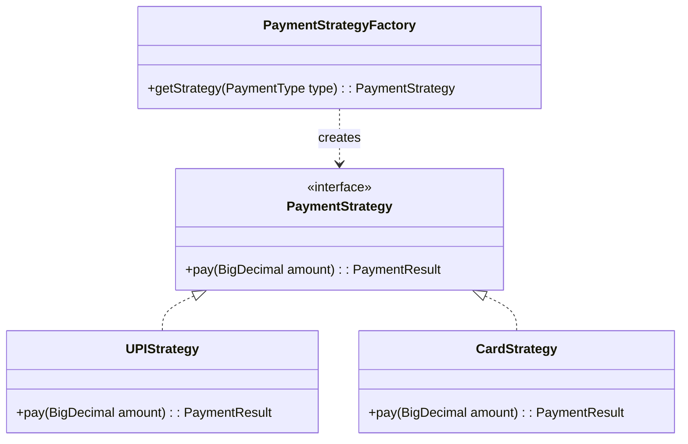
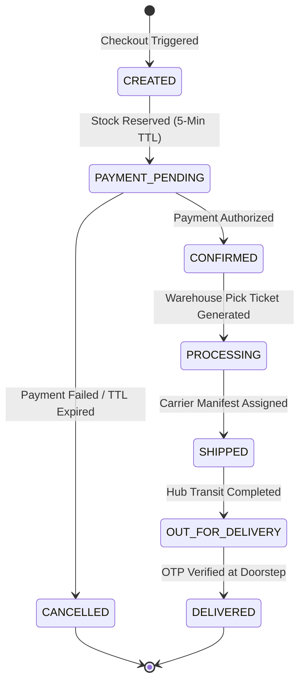
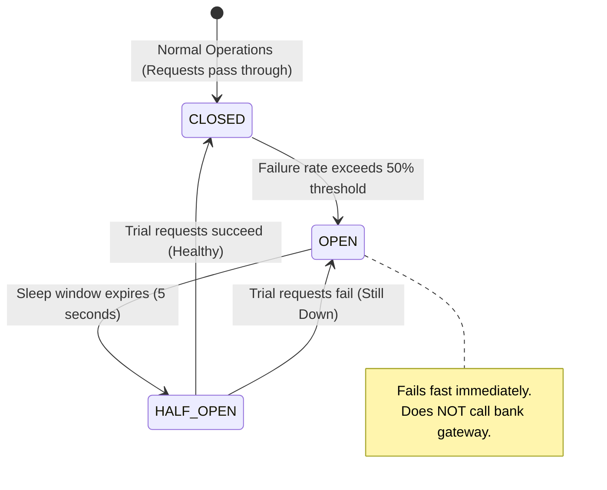

<div align="center">

# 07. GoF and Distributed Design Patterns

[]()
[]()
[]()

[Back to Overview](../README.md) |
[Prev: 06 SOLID Principles](../06_SOLID/README.md) |
[Next: 08 Scalability & Reliability ->](../08_Scalability_Reliability/README.md)

---

</div>

## Design Patterns Overview Matrix

| # | Pattern | Domain / Service | Primary Problem Solved |
|---|---|---|---|
| **1** | **Strategy** | `PaymentService` | Dynamically switch between UPI, Card, and NetBanking algorithms |
| **2** | **Factory** | `PaymentGatewayFactory` | Instantiate appropriate gateway clients at runtime |
| **3** | **State** | `OrderService` | Enforce rigid state transitions (`CREATED` -> `DELIVERED`) |
| **4** | **Observer / Pub-Sub** | `EventBroker` | Decouple order confirmation from Email/SMS & 3PL logistics |
| **5** | **Adapter** | `PaymentGatewayAdapter` | Standardize disparate 3rd-party banking payloads into standard DTOs |
| **6** | **Repository** | Storage Layer | Abstract relational PostgreSQL queries away from domain services |
| **7** | **Facade** | `CheckoutFacade` | Orchestrate cart validation, reservation, and payment behind 1 API |
| **8** | **Circuit Breaker** | `Resilience4j` | Prevent cascading crashes when downstream banking APIs degrade |

---

## 1. Deep Dive: Strategy and Factory Patterns



---

## 2. State Pattern: Order State Transition Engine



---

## 3. Circuit Breaker Pattern (Resilience and Fail-Fast)



<details open>
<summary><b>Circuit Breaker State Transitions (Click to collapse)</b></summary>

1. **`CLOSED`**: All payment requests reach the gateway. Latency and errors are recorded in a rolling sliding window.
2. **`OPEN`**: If error rate surpasses 50%, the circuit trips to `OPEN`. All incoming calls immediately fail with `503 Service Unavailable`, protecting both the payment gateway and internal thread pools.
3. **`HALF-OPEN`**: After 5,000ms, a canary batch of 5 requests is permitted. If they succeed, the system returns to `CLOSED`.

</details>

---

## 4. Facade Pattern (Checkout Orchestration)

```mermaid
graph TD
    Client["Mobile / Web Client"] -->|Single POST /api/checkout| Facade["CheckoutFacade"]
    
    Facade -->|1. Validate| Cart["CartService"]
    Facade -->|2. Hold Stock (5m)| Inv["InventoryService"]
    Facade -->|3. Authorize| Pay["PaymentService"]
    Facade -->|4. Create| Ord["OrderService"]
```

---

[Return to System Overview](../README.md) | [Proceed to 08_Scalability_Reliability ->](../08_Scalability_Reliability/README.md)