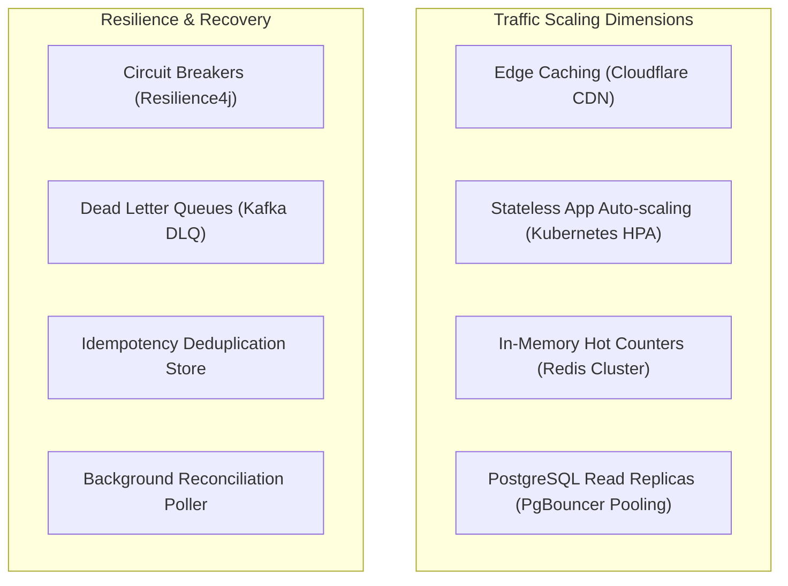
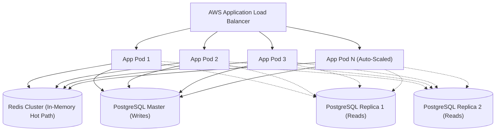
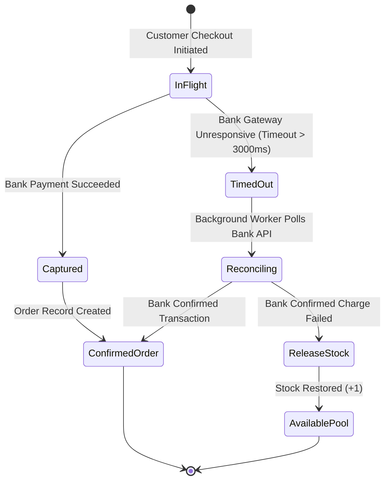

# 08. Scalability, Resilience, and Fault Tolerance

[Back to Overview](../README.md) |
[Prev: 07 Design Patterns](../07_Design_Patterns/README.md) |
[Next: 09 Security & Observability ->](../09_Security_Observability/README.md)

---

## Scalability and Reliability Architecture Overview

---

## 1. Handling Traffic Surges (10,000 to 500,000 RPS)

| Layer | Scaling Mechanism | Sizing & Throughput Strategy |
|---|---|---|
| **DNS & Edge** | Cloudflare Anycast CDN & WAF | Absorbs 90% of read traffic, filters layer-7 bot spikes |
| **API Gateway** | Kong / Spring Cloud Gateway | Token-bucket rate limiting (500 rps/client IP) |
| **Microservices Mesh** | Kubernetes Pod Autoscaler (HPA) | Auto-scales instances based on CPU (>70%) and request queue depth |
| **Caching Layer** | Redis 7.0 Cluster | Sub-millisecond read/write latency; 100,000+ ops/sec per node |
| **Database Master** | PostgreSQL 16 (Write-Optimized) | Row-level versioning, connection pooling via PgBouncer |
| **Database Replicas**| PostgreSQL Read Replicas | Multi-AZ async replication for catalog and order history queries |

---

## 2. Horizontal Scaling Topology

---

## 3. Reliability and Self-Healing Mechanisms

<b>Dead Letter Queue (DLQ) & Auto-Reconciliation Engine (Click to expand/collapse)</b>

### 1. Dead Letter Queue (DLQ) Workflow
- When an asynchronous event (e.g., `OrderConfirmedEvent` for shipment dispatch) fails processing after **3 exponential backoff retries** (1s, 2s, 4s), it is moved to `order.confirmed.dlq`.
- Prevents poison-pill messages from blocking the active partition consumer while triggering an automated SRE alert.

### 2. Automated Reconciliation Poller
- If a payment request times out after 3 seconds, the system does NOT immediately assume failure.
- A scheduled cron worker queries the payment gateway with the `Idempotency-Key` / `transactionReference` every 30 seconds.
- If verified successful, the order transitions to `CONFIRMED`. If verified failed or expired after 5 minutes, the stock reservation is released back to the general pool.

---

[Return to System Overview](../README.md) | [Proceed to 09_Security_Observability ->](../09_Security_Observability/README.md)