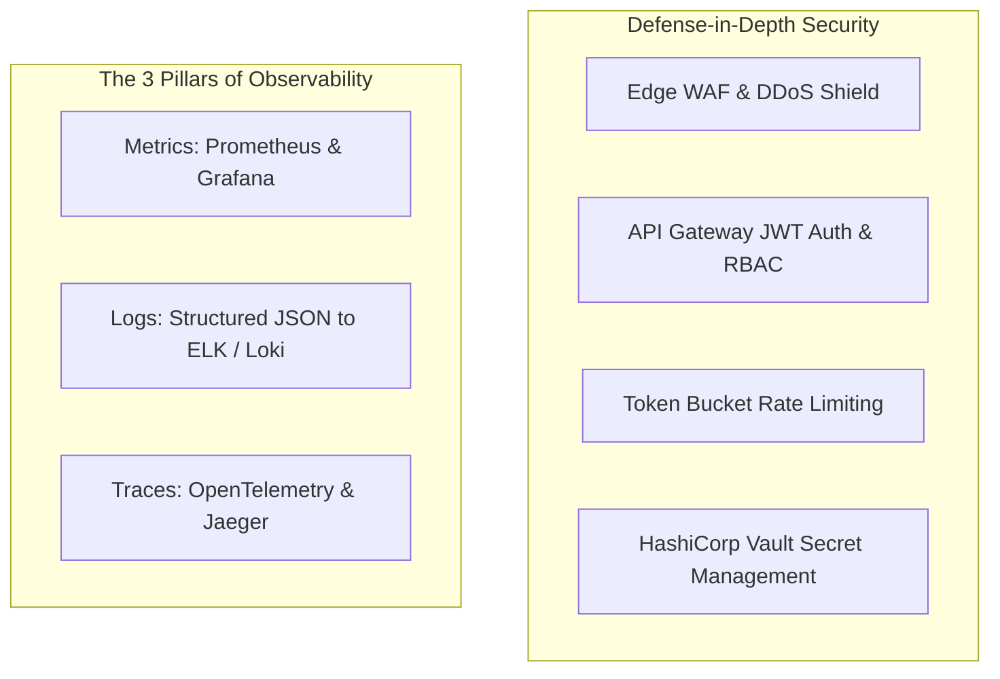
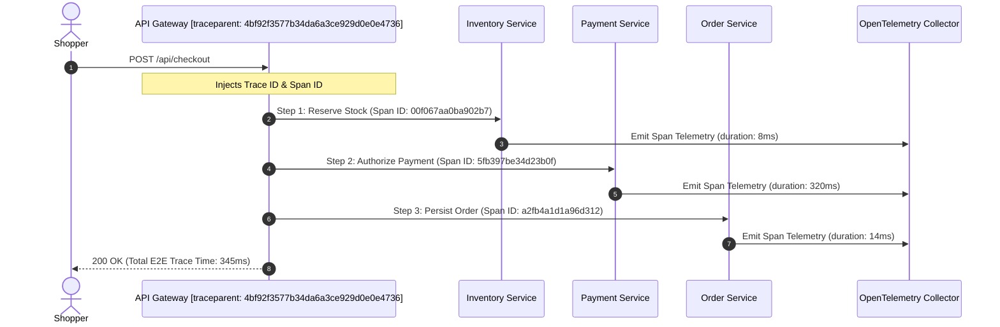

# 09. Security Architecture and SRE Observability

[Back to Overview](../README.md) |
[Prev: 08 Scalability & Reliability](../08_Scalability_Reliability/README.md) |
[Next: 10 Architecture Decision Records ->](../10_ADR/README.md)

---

## Architecture Overview

---

## 1. Multi-Layer Security Architecture

| Security Layer | Threat Addressed | Enforcement Mechanism |
|---|---|---|
| **Edge / WAF** | DDoS, Bot scraping, SQLi, XSS | Cloudflare WAF managed rules, Challenge-response CAPTCHA |
| **API Gateway** | Unauthorized access, token forgery | RS256 signed JWT validation, Role-based Access Control (RBAC) |
| **Rate Limiter** | Brute force, flash-sale endpoint flooding | In-memory token bucket (Redis sliding window: 500 req/min) |
| **Data in Transit** | Man-in-the-Middle eavesdropping | Strict TLS 1.3 encryption with HSTS enabled |
| **Data at Rest** | Database snapshot exposure | AES-256 transparent data encryption (TDE) in PostgreSQL |
| **Secrets Mgmt** | Hardcoded credential leakage | HashiCorp Vault dynamic database & gateway credentials |
| **Audit Trails** | Non-repudiation & fraud analysis | Immutable append-only structured audit logs for all financial mutations |

---

## 2. Distributed Tracing Workflow

---

## 3. SRE Alerting Thresholds and Monitoring Matrix

<b>Critical SRE Metrics and Alert Policies (Click to collapse)</b>

| Metric Name | Target SLA | Warning Threshold | Critical Alert Threshold | Automated Action |
|---|---|---|---|---|
| **P99 API Latency** | < 200 ms | > 500 ms for 2 min | > 1500 ms for 1 min | Trigger Kubernetes HPA scale-out |
| **Payment Failure Rate** | < 2.0% | > 5.0% for 3 min | > 10.0% for 1 min | Trip Resilience4j Circuit Breaker |
| **Inventory Divergence**| 0 units | Stock mismatch detected | Stock mismatch detected | Freeze flash sale & alert on-call SRE |
| **Kafka DLQ Growth** | 0 msg | > 20 msg in 5 min | > 100 msg in 2 min | Page On-Call via PagerDuty |

---

[Return to System Overview](../README.md) | [Proceed to 10_ADR ->](../10_ADR/README.md)