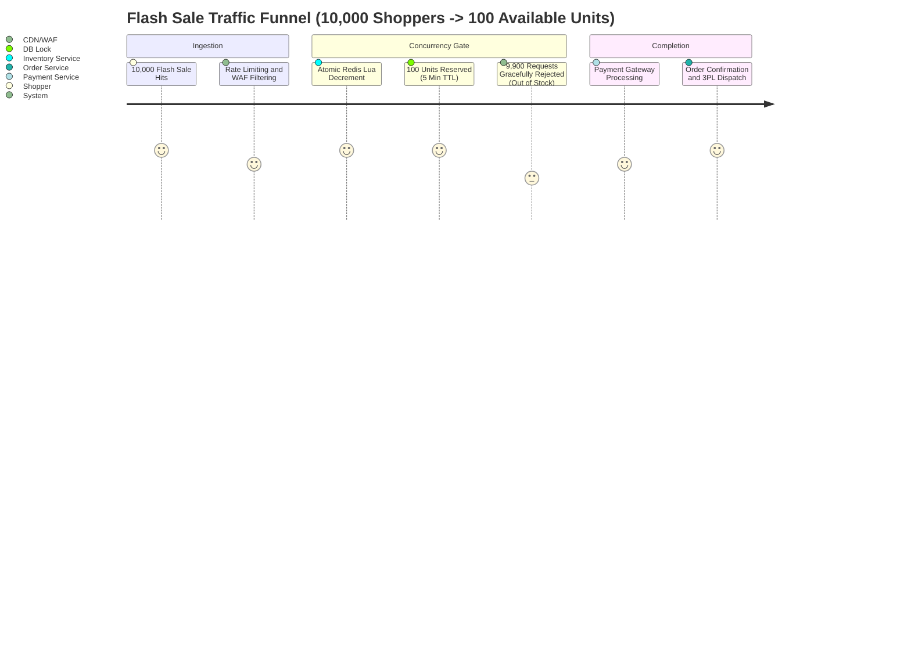
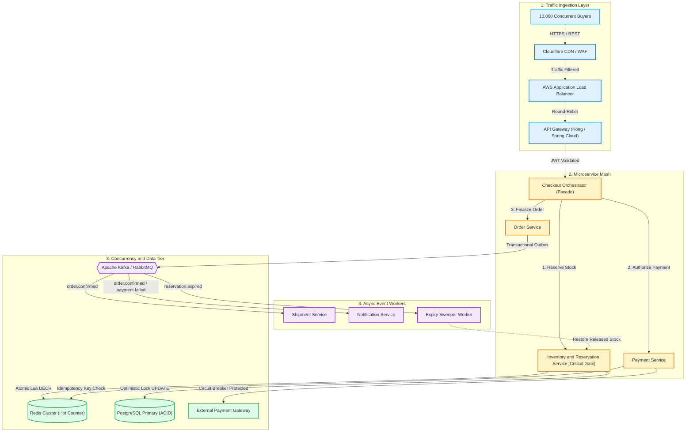
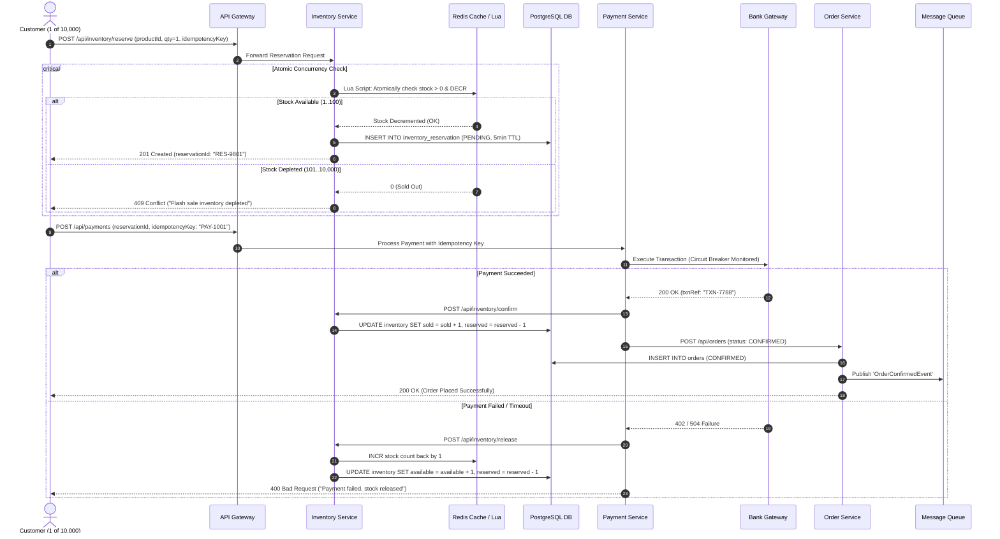

<div align="center">

# SALESTORM — High-Scale E-Commerce Flash Sale System
### *System Architecture, Concurrency Control, and Fault-Tolerant Distributed Design*

[](02_HLD/README.md)
[](03_LLD/README.md)
[](04_Database/README.md)
[](SALESTORM_SYSTEM_FLOW.drawio)
[]()

<p align="center">
  <b>A fault-tolerant, horizontally scalable distributed system engineered to eliminate overselling and race conditions when 10,000 customers compete for 100 flash-sale units.</b>
</p>

[Open Draw.io Flow](SALESTORM_SYSTEM_FLOW.drawio) |
[System HLD](02_HLD/README.md) |
[Low-Level Design](03_LLD/README.md) |
[DB Schema](04_Database/README.md) |
[API Specs](05_API/README.md) |
[ADRs](10_ADR/README.md)

---

</div>

## System Navigation and Architecture Index

| Module | Title | Primary Technical Focus | Documentation Link |
|---|---|---|:---:|
| **01_Requirements** | Requirements and SLAs | Functional and Non-Functional Specs, 10k:100 Flash Sale Core Challenge | [View Specs](01_Requirements/README.md) |
| **02_HLD** | High-Level Design | C4 Model, CDN, Load Balancer, API Gateway, Service Boundaries | [View HLD](02_HLD/README.md) |
| **03_LLD** | Low-Level Design | Sequence Diagrams, Class Hierarchy, Inventory and Order State Machine | [View LLD](03_LLD/README.md) |
| **04_Database** | Database and Storage | PostgreSQL Relational Schemas, Indexing, Concurrency Versioning | [View DB](04_Database/README.md) |
| **05_API** | RESTful API Design | Endpoint Contracts, Idempotency Headers, JSON Payloads | [View APIs](05_API/README.md) |
| **06_SOLID** | SOLID Principles | Clean Architecture Patterns applied across Microservices | [View SOLID](06_SOLID/README.md) |
| **07_Design_Patterns** | Design Patterns | Strategy, Factory, State, Observer, Adapter, Circuit Breaker | [View Patterns](07_Design_Patterns/README.md) |
| **08_Scalability_Reliability** | Scale and Fault Tolerance | 500k RPS scaling, Redis Caching, DLQ, Auto-Reconciliation | [View Scale](08_Scalability_Reliability/README.md) |
| **09_Security_Observability** | Security and SRE | WAF, OAuth2/JWT, Rate Limiting, Prometheus, Distributed Tracing | [View Security](09_Security_Observability/README.md) |
| **10_ADR** | Architecture Decisions | Formal ADRs (PostgreSQL, Optimistic Locking, Redis, Idempotency) | [View ADRs](10_ADR/README.md) |

---

## The Core Flash Sale Challenge



> **The Invariant Guarantee:**  
> If the initial available inventory contains **exactly 100 units**, under zero circumstances can the system produce **101 or more successful sales**, even when subjected to 10,000 concurrent purchase attempts, network partitions, or transient database outages.

---

## Interactive End-to-End System Flow



---

## Purchase and Concurrency Lifecycle Sequence



---

## Concurrency and Anti-Overselling Deep Dive

<details open>
<summary><b>Mechanism: Preventing Overselling Under 10,000 Concurrent Hits (Click to Collapse)</b></summary>

1. **Two-Tier Reservation Model**:
   - **L1 In-Memory Atomic Gate (Redis Lua)**: Evaluates the 10,000 requests in sub-millisecond execution time, issuing exactly 100 reservation tickets.
   - **L2 Database Row Versioning (PostgreSQL)**: Applies optimistic locking with explicit `version` constraints:
   ```sql
   UPDATE inventory 
   SET available_quantity = available_quantity - 1, 
       reserved_quantity = reserved_quantity + 1,
       version = version + 1
   WHERE product_id = :productId 
     AND available_quantity >= 1;
   ```
2. **TTL Auto-Release Expiry**:
   - Every reservation is stamped with a 5-minute `expires_at` timestamp.
   - A Redis TTL key (`reservation:{id}:ttl`) triggers an automated queue event if payment is not settled within 300 seconds, releasing the inventory back to waiting shoppers.
3. **Idempotency Deduplication**:
   - Every checkout action generates a client-side UUID `Idempotency-Key`.
   - Redis enforces a `SETNX` lock preventing double-clicks or duplicate network retries from debiting the user twice or reserving multiple units.

</details>

---

## Technical Architecture Matrix

| Layer | Technology | Primary Role | High Availability / Scalability Tactic |
|---|---|---|---|
| **Edge and CDN** | Cloudflare Enterprise | DDoS and Rate Limiting | Anycast DNS, Edge Caching, Web Application Firewall |
| **API Gateway** | Kong / Spring Cloud Gateway | Routing and Auth | Token bucket rate-limiter, JWT validation, Distributed Tracing headers |
| **Application Mesh** | Java Spring Boot / Go / Node.js | Microservices Business Logic | Stateless horizontally scaled Docker containers in Kubernetes (HPA) |
| **Database** | PostgreSQL 16 | ACID Transactional Store | Master-replica replication, Connection pooling (PgBouncer), Row-level locking |
| **Cache Tier** | Redis 7.0 Cluster | In-Memory Counters and TTL | Redis Sentinel / Cluster Mode with Lua atomic operations |
| **Message Broker** | Apache Kafka / RabbitMQ | Async Decoupling | Partitioned topics, Consumer Groups, Dead Letter Queues (DLQ) |
| **Observability** | Prometheus, Grafana, OpenTelemetry | SRE Telemetry | 99.99th percentile latency metrics, Distributed trace IDs, PagerDuty alerting |

---

## Interactive Flow Diagram (.drawio)

This repository includes a standalone Draw.io architecture file ready for visualization in [diagrams.net](https://app.diagrams.net) or any IDE Draw.io extension:

- **File Path**: [`SALESTORM_SYSTEM_FLOW.drawio`](SALESTORM_SYSTEM_FLOW.drawio)
- **Features Included**:
  - Full Ingestion Layer (Users -> CDN -> ALB -> Gateway)
  - Microservice breakdown with Concurrency Gateways
  - PostgreSQL Master-Replica + Redis In-Memory Cluster
  - Kafka / RabbitMQ Event-Driven Worker pipelines
  - Fallback, Circuit Breaker, and Auto-Reconciliation recovery loops

---

## Quick Start and Repository Access

```bash
# Clone the repository
git clone https://github.com/aju-0812/SYS_DESIGNERS.git

# Navigate into the project
cd SYS_DESIGNERS

# View the full architecture documentation
cat README.md
```